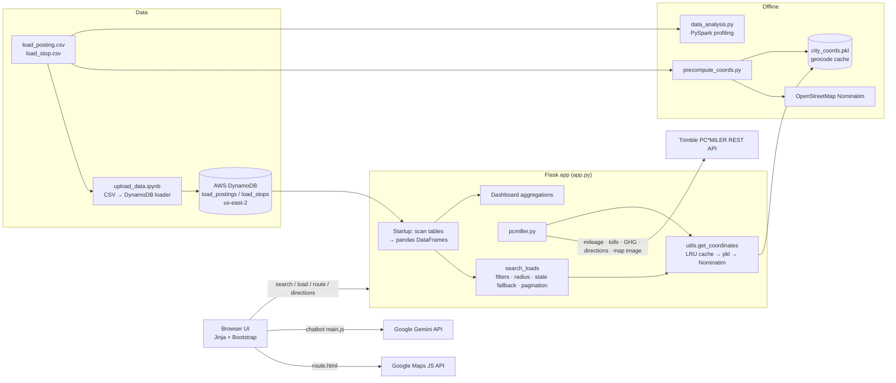

# Freight Load Search

**A carrier-facing search engine for available truckload freight, built by a student team against a project brief from Schneider for its FreightPower app.**

<!-- TODO (Harsh): name the program this was built under (course name/number, capstone, or industry-partner program) and the term, e.g. "Built for <COURSE>, Fall 2024, with Schneider as industry partner." The commit emails point to UW–Madison but the repo never says so; confirm before adding. -->


---

## My contributions (Harsh Sahay, [@Harsh-Sahay009](https://github.com/Harsh-Sahay009))

I built most of the application: the search engine, the external API integrations and the web UI. By `git blame` on the current code, I wrote 901 of the 1,018 lines in `app.py`, all of `pcmiller.py` except 3 lines, and all of `utils.py`, `precompute_coords.py`, `data_analysis.py` and the page templates (teammates added the chatbot markup to `base.html`).

- **Got the first working app running (Oct 2024).** I started the Flask app, loaded the project's load-posting and load-stop data, and built the first search UI with filters and route results.
- **Built the search logic (`search_loads`).** It filters by equipment type and maximum weight, then matches on origin and destination city or state. When the exact city has no loads, it falls back to a **geodesic radius search** around the origin. When a lane comes back empty, it tells the user whether loads exist in the origin or destination *state*, instead of returning a bare "no results". Results are paginated and the search parameters are kept in the URL.
- **Integrated the Trimble PC\*MILER REST API (`pcmiller.py`).** It provides truck-route mileage, drive time, estimated tolls and estimated GHG for each load (`routeReports`, Mileage), turn-by-turn directions (Directions report), and a rendered route-map image for the "Watch" button (`mapRoutes`).
- **Built the geocoding layer.** `precompute_coords.py` batch-geocodes every unique pickup and drop city with OpenStreetMap Nominatim (rate-limited to 1 request/second) into a cache file (`city_coords.pkl`, 1,813 city/state entries). `utils.get_coordinates` puts an in-memory LRU cache in front of it and geocodes any cache misses on demand, writing them back to the file.
- **Built the load-detail and route pages.** These are the load detail page (PC\*MILER mileage, tolls and GHG, plus a simple weight-adjusted fuel-use estimate), an interactive **Google Maps** route page (`/route/<load_id>`), and a directions page (`/directions/<load_id>`).
- **Built the operations dashboard.** It shows load counts by transport mode, top pickup and drop-off cities, the busiest origin-to-destination lanes, and average weight by mode. I also added a collapsible dashboard widget on the search page whose open/closed state persists between visits.
- **Did offline data exploration with PySpark** (`data_analysis.py`). This profiles the dataset by transport mode, stop type, posting status, top cities, average weight and connected city pairs.
- **Built a CSV-backed version of the app** (`testapp.py`) that runs from the local CSVs without AWS.

<!-- TODO (Harsh): add anything that isn't visible in git, e.g. requirement-gathering with Schneider, demo or presentation to Schneider, design decisions you drove, or feedback received. Only include what actually happened. -->

## Team

| Member | Main contributions (from git history) |
|---|---|
| Harsh Sahay ([@Harsh-Sahay009](https://github.com/Harsh-Sahay009)) | Core Flask app, search and filters, PC\*MILER, geocoding and Google Maps integration, dashboard, UI (see above) |
| Saarthak Aggarwal ([@SaarSaar223](https://github.com/SaarSaar223), repo owner [@saarthakaggarwal](https://github.com/saarthakaggarwal)) | Moved the data layer from CSV to **AWS DynamoDB** (`upload_data.ipynb` loader + paginated table scans), kept search parameters in cookies, Decimal-safe fuel calculation |
| Changlin Hu (commit author `changlin`) | Project README and setup docs, `requirements.txt`, environment-based AWS credentials, `.gitignore` and repo cleanup, **Gemini-powered support chatbot** |

<!-- TODO (Harsh): confirm teammates' preferred names and GitHub handles. Names here are inferred from commit emails and the upstream repo owner (saarthakaggarwal); add Changlin's GitHub handle. -->

---

## The problem

Schneider FreightPower is Schneider's app for small and mid-sized trucking companies that haul freight for its brokerage division. Carriers use it to find and book available loads, assign them to drivers and post updates as the freight moves. According to the project brief, more than 17,000 unique users log in each month, and **load search** is one of their most important tools.

The brief asked for a new search engine for available freight. It had to support origin/destination, freight type and mileage-radius criteria, follow the business rules, and focus on the carrier's experience over a polished UI.

The underlying data is two operational tables: **load postings** (load ID, status, transport mode, weight, distance, hazmat/high-value/temperature flags) and **load stops** (the pickups and drop-offs for each load, with city, state, postal code and appointment windows). The copies in this repo hold 3,575 postings and 7,229 stops. Turning those into a useful search means joining stops to loads, working out each load's origin and destination, and handling the common case where nothing matches exactly.

## What we built

The result is a Flask web app that a carrier can use to:

1. **Search loads** by equipment type (Dry Van, Power Only, Power Only Team, Refrigerated), maximum weight, origin and destination city or state, and a mileage radius around the origin.
2. **Get a useful answer when there's no exact match.** The search widens to a radius around the origin city and says when loads exist elsewhere in the origin or destination state.
3. **Preview the route** of any result inline as a truck-routed map image from PC\*MILER.
4. **Open a load** to see miles, drive time, estimated tolls and estimated GHG emissions from PC\*MILER, plus a fuel-use estimate, with links to an interactive Google Maps route and turn-by-turn directions.
5. **Check the market** on a dashboard of the busiest lanes, top pickup and drop-off cities, and load mix by mode.
6. **Ask an AI assistant** (Gemini) general questions about using FreightPower.

## Architecture



**Request flow for a search:** the browser posts the filters to `/`, and `search_loads` filters the in-memory postings and joins them with each load's first pickup and last drop-off. If the origin city has no loads, it geocodes the origin and all candidate pickup cities (cache first) and keeps the loads within the radius by geodesic distance. The results are paginated, and selecting **Watch** calls `/get_map`, which asks PC\*MILER for a route image.

### Main routes

| Route | Purpose |
|---|---|
| `/` | Search form and paginated results |
| `/get_map?load_id=` | PC\*MILER route-map PNG for a load |
| `/load/<load_id>` | Load details: PC\*MILER miles, hours, tolls, GHG, fuel estimate |
| `/route/<load_id>` | Interactive Google Maps route |
| `/directions/<load_id>` | PC\*MILER turn-by-turn directions |
| `/dashboard` | Lane, city and mode analytics |
| `/get_states_for_city` | Fills the state dropdown for a selected city |
| `/get-api-key` | Gives the Gemini key to the chatbot (see limitations) |

## Key features

- **Fallback search instead of empty results.** If the exact city has no loads, the search widens to the radius; if the lane is still empty, it reports state-level availability.
- **Commercial truck-routing data** from PC\*MILER (miles, hours, tolls, GHG, directions) in place of straight-line distance.
- **Geocoding built for repeated lookups.** City coordinates are batch-precomputed, held in an in-memory LRU cache, and geocoded on demand for any misses, so search doesn't hit a rate-limited geocoder for every row.
- **A cloud data layer.** Load data lives in DynamoDB and is read with paginated scans. A notebook loads it from the source CSVs, converting floats to `Decimal` for DynamoDB.
- **Operations dashboard** of the top lanes and cities from the live dataset.
- **An AI support assistant** built on Gemini 1.5 Pro, with a system prompt holding FreightPower FAQs and tone guidelines.
  <!-- TODO (Harsh): the FAQ and contact details in static/main.js (support emails, office hours, policies) look like sample text. Verify them or label them as placeholder content before showcasing. -->

<!-- TODO (Harsh): the only result evidence in the repo is the screenshot. If you have real outcomes (Schneider feedback, a demo, a ranking, latency numbers you measured), add them here. Don't estimate any. -->

## Tech stack

- **Backend:** Python, Flask, pandas, geopy, cachetools, backoff, requests, python-dotenv
- **Data:** AWS DynamoDB (boto3), CSV, pickle geocode cache, PySpark (offline analysis)
- **External APIs:** Trimble PC\*MILER REST API, Google Maps JavaScript API, OpenStreetMap Nominatim, Google Gemini (`@google/generative-ai`)
- **Frontend:** Jinja2 templates, Bootstrap 5, vanilla JS

---

## Running locally

**Prerequisites:** Python 3.9+, plus API keys for PC\*MILER, Google Maps and Google Gemini. For `app.py` you also need AWS credentials that can read DynamoDB tables named `load_postings` and `load_stops` in `us-east-2`.

```bash
git clone https://github.com/Harsh-Sahay009/freight-load-search.git
cd freight-load-search

python3 -m venv venv
source venv/bin/activate          # Windows: venv\Scripts\activate
pip install -r requirements.txt
pip install boto3                 # used by app.py but not yet listed in requirements.txt

cp .env.example .env              # then fill in your own keys
```

`.env.example` lists every environment variable the code reads: `SECRET_KEY`, `GOOGLE_MAPS_API_KEY`, `GOOGLE_GENAI_API_KEY`, `PCMILER_API_KEY`, `AWS_ACCESS_KEY_ID` and `AWS_SECRET_ACCESS_KEY`. `app.py` exits at startup if `SECRET_KEY`, `GOOGLE_MAPS_API_KEY` or `GOOGLE_GENAI_API_KEY` is missing.

**Option A: full app on DynamoDB**

1. Create DynamoDB tables `load_postings` and `load_stops` in `us-east-2`.
   <!-- TODO (Harsh): document the key schemas (probably LOAD_ID for load_postings and LOAD_ID + STOP_ID for load_stops, judging by upload_data.ipynb). The repo doesn't record them. -->
2. Load the data by running the cells in `upload_data.ipynb`, which reads `load_posting.csv` and `load_stop.csv`.
3. `python3 app.py`, then open http://127.0.0.1:5000

**Option B: local CSVs, no AWS**

```bash
python3 testapp.py
```

`testapp.py` is the CSV-backed version of the app. It needs `SECRET_KEY` and `GOOGLE_MAPS_API_KEY` to start, and `PCMILER_API_KEY` for maps and mileage. The chatbot widget won't connect in this mode (it has no `/get-api-key` route).

**Optional:** to rebuild the geocode cache, run `python3 precompute_coords.py`, which takes about 1 second per city. For the Spark data profile, run `pip install pyspark && python3 data_analysis.py`.

---

## Known limitations and next steps

These are recorded honestly, partly from the team's original notes:

- **Data is loaded into memory at startup** with full-table DynamoDB scans. Fine for this dataset, but production would need indexed queries, for example on origin state or mode.
- **The radius search only runs when the exact origin city has no loads.** It should also be offered alongside exact matches.
- **Date-window filtering** (pickup and delivery appointments) was in the brief but isn't in the current search.
- **The Gemini API key is sent to the browser** via `/get-api-key`. Chat calls should go through a server-side proxy instead.
- **No automated tests or CI**, and error handling around AWS and third-party API failures is limited.
- `requirements.txt` is missing `boto3`, and `pyspark` for the analysis script. Some templates (`track.html`, `carrier_match.html`, `optimized_route.html`, `search_results.html`) are unused stubs for future features.

<!-- TODO (Harsh): before pinning this repo, rotate or revoke the PC*MILER keys (two different ones), the Google Maps key, the AWS access key pair and the Flask SECRET_KEY. All of these were committed in this repo's git history (.env / e.env, and a commented-out key in an old pcmiller.py). Then consider purging the history. -->
